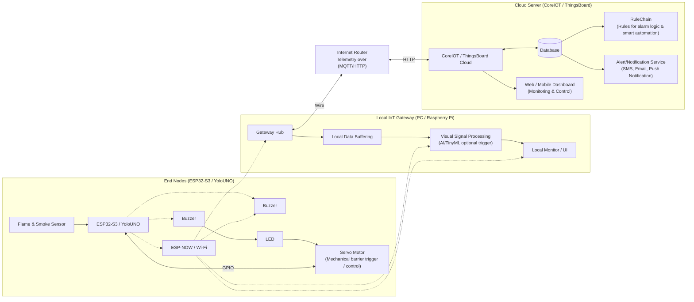

# BÀI TẬP LỚN MÔN IOT
## ĐỀ TÀI: HỆ THỐNG BÁO CHÁY

### 1. Giới thiệu
Phát triển hệ thống báo cháy đơn giản với các tính năng chính:
- Cảm biến nhận diện báo hiệu có cháy
- Còi báo hiệu
- Màn hình hiển thị cảnh báo
- Servo quay (tượng trưng cho thao tác đóng cửa, hay hạ thang cuốn khẩn cấp)

### 2. Phân tích hệ thống

Kiến trúc hệ thống gồm 3 lớp chính: **End Nodes**, **Local IoT Gateway**, và **Cloud Server**.

**Chi tiết các thành phần trong sơ đồ:**
- **End Nodes (ESP32-S3 / YoloUNO):**
  - **Flame & Smoke Sensor:** Cảm biến lửa và khói gửi tín hiệu đầu vào cho ESP32-S3.
  - **Cơ cấu chấp hành & cảnh báo cục bộ:** Buzzer (còi báo), LED (đèn cảnh báo), và Servo Motor (kết nối qua GPIO để đóng/mở rào chắn cơ khí hoặc điều khiển khẩn cấp).
  - **Giao tiếp:** Kết nối với Gateway thông qua **ESP-NOW / Wi-Fi**.
- **Local IoT Gateway (PC / Raspberry Pi):**
  - **Gateway Hub:** Trung tâm tiếp nhận dữ liệu từ End Nodes và giao tiếp hai chiều (Wire) với Internet Router.
  - **Local Data Buffering:** Bộ đệm lưu trữ dữ liệu cục bộ.
  - **Visual Signal Processing (AI/TinyML optional trigger):** Xử lý tín hiệu hình ảnh / kích hoạt AI hoặc TinyML (tùy chọn).
  - **Local Monitor / UI:** Màn hình giám sát và giao diện điều khiển cục bộ.
- **Kết nối mạng:** Internet Router truyền tải dữ liệu Telemetry thông qua **MQTT / HTTP**.
- **Cloud Server (CoreIOT / ThingsBoard):**
  - **Database:** Lưu trữ dữ liệu từ hệ thống.
  - **RuleChain:** Xử lý logic báo động và tự động hóa thông minh (*Rules for alarm logic & smart automation*).
  - **Alert/Notification Service:** Dịch vụ gửi cảnh báo qua SMS, Email, Push Notification.
  - **Web / Mobile Dashboard:** Giao diện giám sát và điều khiển từ xa (*Monitoring & Control*).

### 3. Hiện thực hệ thống
Trình bày chi tiết sơ đồ đấu nối mạch ESP32-S3 (YoloUNO) với cảm biến, LED, Buzzer, Servo, kèm theo cấu hình phần mềm trên IoT Gateway và CoreIOT.

### 4. Đo đạc, thử nghiệm
Thiết kế kịch bản thử nghiệm giả lập sự cố cháy, đo đạc thời gian trễ từ lúc cảm biến nhận tín hiệu đến khi Servo quay, đánh giá tính ổn định của hệ thống.

### 5. Kết luận – Mở rộng
Đánh giá kết quả, chỉ ra các hạn chế kỹ thuật hiện tại và đề xuất hướng phát triển tiếp theo.