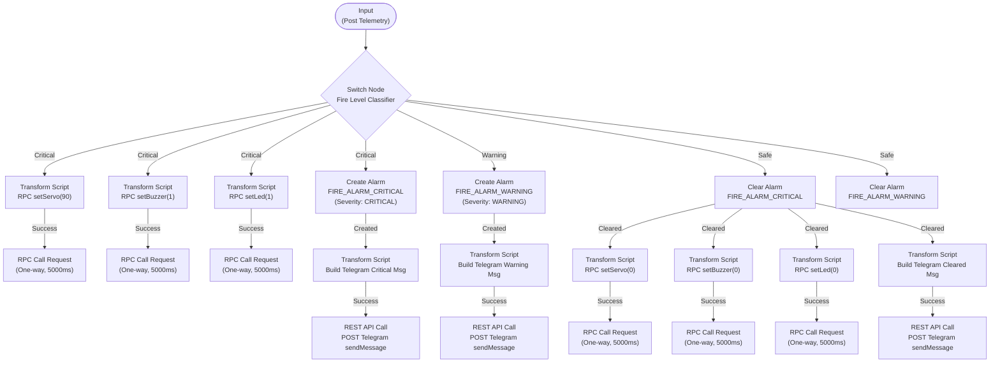

# Hướng dẫn Cấu hình RuleChain (T12) & Cảnh báo Telegram (T13) trên CoreIOT / ThingsBoard

Tài liệu này mô tả chi tiết cấu trúc **RuleChain**, kịch bản xử lý logic bằng **TBEL / JavaScript**, 3 nhánh điều khiển **One-way RPC** và tích hợp **Telegram Bot Alert** thông qua `REST API Call` node. Toàn bộ tên key telemetry, tên method RPC và ngưỡng cảnh báo được thiết kế **khớp 100%** với `02_Local_Gateway/hardware_gateway/LocalGateway.py`, `02_Local_Gateway/ui/gateway_infrastructure.py` và `02_Local_Gateway/dashboard/thingsboard_dashboard.json`.

---

## 1. Bảng ánh xạ Dữ liệu & Giao thức (Khớp 100% với Gateway)

### 1.1. Thông số kết nối MQTT (từ `LocalGateway.py`)

| Tham số | Giá trị mặc định | Ghi chú |
| :--- | :--- | :--- |
| **CoreIOT Cloud Broker** | `app.coreiot.io:1883` | Hoặc `localhost:1883` khi chạy ThingsBoard Docker (N07) |
| **Device Name** | `FireAlarm_Gateway` | Khai báo trong `setup_thingsboard_dashboard.py` |
| **Device Access Token** | `i2tchqq1390qcxhun4zr` | Có thể thay đổi qua `--token` |
| **Telemetry Topic (Uplink)** | `v1/devices/me/telemetry` | QoS 1 |
| **RPC Request Topic (Downlink)** | `v1/devices/me/rpc/request/+` | Gateway subscribe |
| **RPC Response Topic (ACK)** | `v1/devices/me/rpc/response/{req_id}` | Gateway trả `{"status": "SUCCESS", "applied": {...}}` |

### 1.2. Các Key Telemetry (Uplink)

| Key Telemetry | Kiểu dữ liệu | Đơn vị / Giá trị | Nguồn tạo & Hiển thị |
| :--- | :---: | :---: | :--- |
| `smoke` | `float` | `ppm` | Cảm biến khói MQ-2 (Radial Gauge + Timeseries Chart) |
| `flame` | `int` | `0` (An toàn), `1` (Có lửa) | Cảm biến lửa quang học (Digital Gauge + Timeseries Chart) |
| `temperature` | `float` | `°C` (mặc định `24.0` nếu thiếu) | Cảm biến nhiệt độ (Timeseries Chart + đầu vào AI) |
| `is_anomaly` | `int` | `0` (Bình thường), `1` (Bất thường) | AI `IsolationDetector` tại Gateway (AI Anomaly Status) |
| `anomaly_score` | `float` | `0.00` – `1.00` | AI `IsolationDetector` tại Gateway (Anomaly Score Gauge + Chart) |
| `servo` | `int` | `0` (Mở), `90` (Đóng cửa chống cháy) | Trạng thái cơ cấu chấp hành Servo |
| `buzzer` | `int` | `0` (Tắt), `1` (Đang hú còi) | Trạng thái còi báo động |
| `led` | `int` | `0` (Tắt), `1` (Đang nháy đỏ) | Trạng thái đèn cảnh báo |

### 1.3. Các Method RPC được hỗ trợ (Downlink)

Trong `LocalGateway.py` (dòng 215–224), mỗi bản tin RPC xử lý **một method đơn lẻ**, nên RuleChain cần tách thành **3 nhánh RPC song song**:

| Cơ cấu chấp hành | `method` (chuẩn Dashboard) | Alias chấp nhận | `params` khi **Cháy (Critical)** | `params` khi **An toàn (Clear)** |
| :--- | :--- | :--- | :---: | :---: |
| **Cửa chống cháy (Servo)** | `setServo` | `servo` | `90` (độ - Đóng cửa) | `0` (độ - Mở cửa) |
| **Còi báo động (Buzzer)** | `setBuzzer` | `buzzer` | `1` (Bật còi) | `0` (Tắt còi) |
| **Đèn cảnh báo (LED)** | `setLed` | `led` | `1` (Bật đèn nháy) | `0` (Tắt đèn) |

### 1.4. Bảng ngưỡng phân loại 4 giai đoạn (Khớp `gateway_infrastructure.py` & `README.md`)

| Trạng thái | Điều kiện kích hoạt | Hành động của RuleChain |
| :--- | :--- | :--- |
| **CRITICAL** (Cháy khẩn cấp) | `flame == 1` **HOẶC** `smoke > 60.0` **HOẶC** (`is_anomaly == 1` **VÀ** `anomaly_score >= 0.80`) | Tạo Alarm `FIRE_ALARM_CRITICAL` + Gửi 3 lệnh RPC (`setServo(90)`, `setBuzzer(1)`, `setLed(1)`) + Gửi cảnh báo Telegram (khi `Created`) |
| **WARNING** (Cảnh báo sớm) | Không phải Critical, **VÀ** (`35.0 <= smoke <= 60.0` **HOẶC** `is_anomaly == 1`) | Tạo Alarm `FIRE_ALARM_WARNING` + Gửi cảnh báo sớm Telegram (khi `Created`) |
| **SAFE / CLEAR** (An toàn) | `flame == 0` **VÀ** `smoke < 35.0` **VÀ** `is_anomaly == 0` | Xóa Alarm (`Clear Alarm`) + Khi `Cleared` gửi 3 lệnh RPC tắt thiết bị (`setServo(0)`, `setBuzzer(0)`, `setLed(0)`) + Gửi Telegram thông báo an toàn |

> **Lưu ý đồng bộ Dashboard:** Trên `gateway_infrastructure.py` (Local UI) và `README.md`, ngưỡng báo cháy là `Normal < 35 ppm | Warning 35-60 ppm | Alarm > 60 ppm` (khớp với `SimulationNode.py` phát `8-32 ppm` khi bình thường và `75-98 ppm` khi cháy). Nếu cảm biến MQ-2 thực tế xuất giá trị lớn hơn (thang 0–1000 ppm như gauge trong `thingsboard_dashboard.json`), chỉ cần chỉnh 2 hằng số `SMOKE_WARN` và `SMOKE_CRIT` trong node `Switch` bên dưới.

---

## 2. Sơ đồ Kiến trúc RuleChain (Fire Alarm Rule Chain)

Trong **Root Rule Chain**, sau node `Save Timeseries`, nối đầu ra `Success` tới node `Rule Chain` trỏ sang Rule Chain con tên **`Fire_Alarm_Rule_Chain`** (hoặc nối trực tiếp các node bên dưới ngay sau `Save Timeseries`).



> **Tại sao nhánh Telegram nối từ quan hệ `Created` (và `Cleared`) thay vì nối trực tiếp từ `Switch`?**  
> EndNode gửi telemetry liên tục mỗi 3 giây. Nếu nối thẳng từ `Switch`, Telegram sẽ bị spam tin nhắn mỗi 3 giây suốt thời gian cháy. Nối từ đầu ra **`Created`** của `Create Alarm` đảm bảo Telegram chỉ gửi **1 lần duy nhất** khi sự cố cháy mới phát sinh (và 1 lần khi `Cleared`). Trong khi đó, 3 nhánh RPC nối thẳng từ `Critical` giúp kích hoạt tức thời (và đảm bảo đo độ trễ E2E chính xác từng chu kỳ).

---

## 3. Hướng dẫn Cấu hình Chi tiết Từng Node

### Node 1: `Switch` (Filter → Switch)
- **Name:** `Fire Level Classifier`
- **Ngôn ngữ:** `TBEL` (mặc định trên CoreIOT / ThingsBoard 3.x)

```java
// TBEL Script - Fire Level Classifier
var SMOKE_WARN = 35.0;
var SMOKE_CRIT = 60.0;

var smoke = (msg.smoke != null) ? Double.parseDouble(String.valueOf(msg.smoke)) : 0.0;
var flame = (msg.flame != null) ? Integer.parseInt(String.valueOf(msg.flame)) : 0;
var isAnomaly = (msg.is_anomaly != null) ? Integer.parseInt(String.valueOf(msg.is_anomaly)) : 0;
var anomalyScore = (msg.anomaly_score != null) ? Double.parseDouble(String.valueOf(msg.anomaly_score)) : 0.0;

if (flame == 1 || smoke > SMOKE_CRIT || (isAnomaly == 1 && anomalyScore >= 0.80)) {
    return ['Critical'];
} else if (smoke >= SMOKE_WARN || isAnomaly == 1) {
    return ['Warning'];
} else {
    return ['Safe'];
}
```

<details>
<summary>Phiên bản JavaScript (dùng nếu chọn JS thay vì TBEL)</summary>

```javascript
var SMOKE_WARN = 35.0;
var SMOKE_CRIT = 60.0;

var smoke = Number(msg.smoke || 0);
var flame = Number(msg.flame || 0);
var isAnomaly = Number(msg.is_anomaly || 0);
var anomalyScore = Number(msg.anomaly_score || 0);

if (flame === 1 || smoke > SMOKE_CRIT || (isAnomaly === 1 && anomalyScore >= 0.80)) {
    return ['Critical'];
} else if (smoke >= SMOKE_WARN || isAnomaly === 1) {
    return ['Warning'];
} else {
    return ['Safe'];
}
```
</details>

- **Kết nối đầu ra (Relations):** `Critical`, `Warning`, `Safe`.

---

### Node 2: `Create Alarm` & `Clear Alarm` (Action)

#### 2.1. `Create Alarm` — Nhánh `Critical`
- **Name:** `Create Fire Critical Alarm`
- **Alarm type:** `FIRE_ALARM_CRITICAL`
- **Alarm severity:** `CRITICAL`
- **Propagate:** Bật (tùy chọn nếu cần lan truyền lên Asset/Tòa nhà)
- **Alarm details builder (TBEL):**

```java
var details = {};
if (metadata.prevAlarmDetails != null) {
    details = JSON.parse(metadata.prevAlarmDetails);
}
details.smoke = msg.smoke;
details.flame = msg.flame;
details.temperature = (msg.temperature != null) ? msg.temperature : 24.0;
details.is_anomaly = msg.is_anomaly;
details.anomaly_score = msg.anomaly_score;
details.action = "AUTO_LOCKDOWN: Servo=90, Buzzer=1, LED=1";
return details;
```

#### 2.2. `Create Alarm` — Nhánh `Warning`
- **Name:** `Create Fire Warning Alarm`
- **Alarm type:** `FIRE_ALARM_WARNING`
- **Alarm severity:** `WARNING`
- **Alarm details builder (TBEL):** tương tự trên, đổi `details.action = "EARLY_WARNING_MONITORING"`.

#### 2.3. `Clear Alarm` — Nhánh `Safe`
Tạo **2 node `Clear Alarm`** nối song song từ nhánh `Safe` của `Switch`:
- **Node 2.3a:** Name: `Clear Critical Alarm`, Alarm type: `FIRE_ALARM_CRITICAL`.
- **Node 2.3b:** Name: `Clear Warning Alarm`, Alarm type: `FIRE_ALARM_WARNING`.

---

### Node 3: 3 Nhánh RPC One-way (Transformation → Script + Action → RPC Call Request)

Mỗi lệnh điều khiển thiết bị chấp hành cần một cặp **`Transform Script` → `RPC Call Request`**:

#### 3.1. Nhánh Critical (Kích hoạt khóa khẩn cấp)

1. **Transform Script — `RPC setServo(90)`:**
```java
// TBEL
var newMsg = {
    "method": "setServo",
    "params": 90
};
return {msg: newMsg, metadata: metadata, msgType: msgType};
```

2. **Transform Script — `RPC setBuzzer(1)`:**
```java
// TBEL
var newMsg = {
    "method": "setBuzzer",
    "params": 1
};
return {msg: newMsg, metadata: metadata, msgType: msgType};
```

3. **Transform Script — `RPC setLed(1)`:**
```java
// TBEL
var newMsg = {
    "method": "setLed",
    "params": 1
};
return {msg: newMsg, metadata: metadata, msgType: msgType};
```

#### 3.2. Nhánh Cleared (Khôi phục trạng thái an toàn)
Nối từ đầu ra **`Cleared`** của `Clear Critical Alarm` tới 3 cặp tương tự với giá trị tắt:
- `{"method": "setServo", "params": 0}`
- `{"method": "setBuzzer", "params": 0}`
- `{"method": "setLed", "params": 0}`

#### 3.3. Cấu hình Node `RPC Call Request` (áp dụng chung cho các nhánh RPC)
- **Type:** Action → `rpc call request`
- **Timeout in seconds:** `5`
- **One-way RPC:** Để tránh RuleChain treo chờ phản hồi khi Gateway đang ngoại tuyến, trong CoreIOT/ThingsBoard 3.x:
  - Trên các phiên bản có tùy chọn `oneway`: đặt `oneway = true` (hoặc truyền `metadata.oneway = "true"`).
  - Nếu phiên bản CoreIOT chỉ dùng node `rpc call request` tiêu chuẩn, `LocalGateway.py` đã tự động gửi ACK về `v1/devices/me/rpc/response/{req_id}` (dòng 227–228) nên yêu cầu luôn thành công ngay lập tức mà không bị timeout.

---

### Node 4: Cảnh báo Telegram qua `REST API Call` (T13 - 0.5đ)

#### Bước 4.1. Chuẩn bị Telegram Bot (làm 1 lần)
1. Mở Telegram, nhắn cho **`@BotFather`** lệnh `/newbot` → đặt tên bot → lưu lại **`BOT_TOKEN`** (dạng `123456789:ABCdef...`).
2. Nhắn một tin bất kỳ (ví dụ `/start`) vào bot vừa tạo (hoặc thêm bot vào nhóm cảnh báo).
3. Mở trình duyệt truy cập:
   `https://api.telegram.org/bot<BOT_TOKEN>/getUpdates`
   Tìm trường `"chat": {"id": ...}` để lấy **`CHAT_ID`** (số dương cho cá nhân, số âm cho nhóm).

#### Bước 4.2. Node `Transform Script` — Tạo nội dung Telegram (nối từ `Create Fire Critical Alarm` qua relation `Created`)
- **Name:** `Build Telegram Critical Payload`
- **Script (TBEL):**

```java
// TBEL - Format Telegram Alert Message
var deviceName = (metadata.deviceName != null) ? metadata.deviceName : "FireAlarm_Gateway";
var details = (msg.details != null) ? msg.details : msg;

var smoke = (details.smoke != null) ? details.smoke : "N/A";
var flame = (details.flame != null) ? details.flame : "N/A";
var temp = (details.temperature != null) ? details.temperature : "N/A";
var score = (details.anomaly_score != null) ? details.anomaly_score : "N/A";

var text = "[CRITICAL FIRE ALARM]\n"
    + "Device: " + deviceName + "\n"
    + "Smoke: " + smoke + " ppm\n"
    + "Flame: " + flame + "\n"
    + "Temperature: " + temp + " C\n"
    + "AI Anomaly Score: " + score + "\n"
    + "Auto Action: Servo=90 (Closed), Buzzer=ON, LED=ON";

var newMsg = {
    "chat_id": "<YOUR_TELEGRAM_CHAT_ID>",
    "text": text
};

return {msg: newMsg, metadata: metadata, msgType: "POST_TELEMETRY_REQUEST"};
```

*(Tương tự cho nhánh `Warning` với tiêu đề `[WARNING] Early Smoke/Anomaly Detected`, và nhánh `Cleared` với tiêu đề `[RESOLVED] Fire Alarm Cleared - System Safe`.)*

#### Bước 4.3. Node `REST API Call` (External → REST API Call)
- **Name:** `Send Telegram Alert`
- **Endpoint URL pattern:**
  `https://api.telegram.org/bot<YOUR_BOT_TOKEN>/sendMessage`
- **Request method:** `POST`
- **Use simple client HTTP factory:** Bật (nếu gặp lỗi SSL trên một số bản cũ)
- **Read timeout in millis:** `5000`
- **Headers:**
  - Key: `Content-Type` | Value: `application/json`
- **Enable proxy / Ignore body:** Tắt (mặc định).

> **Bảo mật khi nộp Git:** Không commit `BOT_TOKEN` và `CHAT_ID` thật vào file JSON export hay Markdown. Khi export RuleChain ra `03_CoreIOT_Config/rule_chains/fire_alarm_rule_chain.json`, hãy thay bằng `<YOUR_BOT_TOKEN>` và `<YOUR_TELEGRAM_CHAT_ID>`.

---

## 4. Quy trình Kiểm thử & Thu thập Minh chứng (T12, T13 & Chương 4)

Sau khi lưu và kích hoạt RuleChain trên CoreIOT (hoặc ThingsBoard Local):

1. **Kiểm thử 4 giai đoạn (Safe → Warning → Critical → Clear):**
   ```bash
   # Test trên CoreIOT Cloud
   python 03_CoreIOT_Config/scripts/test_rulechain_alert.py --broker app.coreiot.io --token i2tchqq1390qcxhun4zr

   # Hoặc test trên ThingsBoard Docker Local (N07)
   python 03_CoreIOT_Config/scripts/test_rulechain_alert.py --broker localhost --token i2tchqq1390qcxhun4zr
   ```
   *(Thêm cờ `--interactive` để nhấn Enter chuyển từng giai đoạn khi quay Video Demo.)*

2. **Đo độ trễ khứ hồi E2E tự động 10 lần:**
   ```bash
   python 03_CoreIOT_Config/scripts/measure_latency.py --broker app.coreiot.io --token i2tchqq1390qcxhun4zr --trials 10
   ```
   Kết quả chi tiết từng lần đo được tự động lưu tại `04_Docs_Media/experiments/latency_results.csv` kèm bảng thống kê **Min / Max / Avg** in ra terminal để đưa thẳng vào **Bảng 4.1** của báo cáo.

3. **Checklist ảnh chụp minh chứng cần lưu vào `04_Docs_Media/media/`:**
   - `rulechain_diagram.png`: Ảnh toàn cảnh sơ đồ RuleChain trên CoreIOT.
   - `rulechain_switch_node.png`: Ảnh cấu hình Switch Node và ngưỡng cháy.
   - `dashboard_alarm_active.png`: Ảnh Dashboard khi `FIRE_ALARM_CRITICAL` đang kích hoạt.
   - `alert_notification_proof.png`: Ảnh chụp màn hình tin nhắn cảnh báo cháy nhận được trên Telegram.
