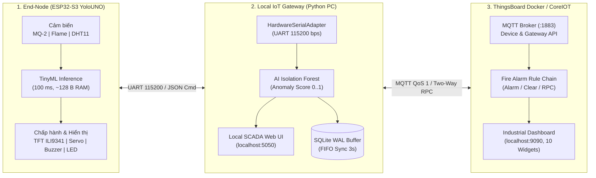
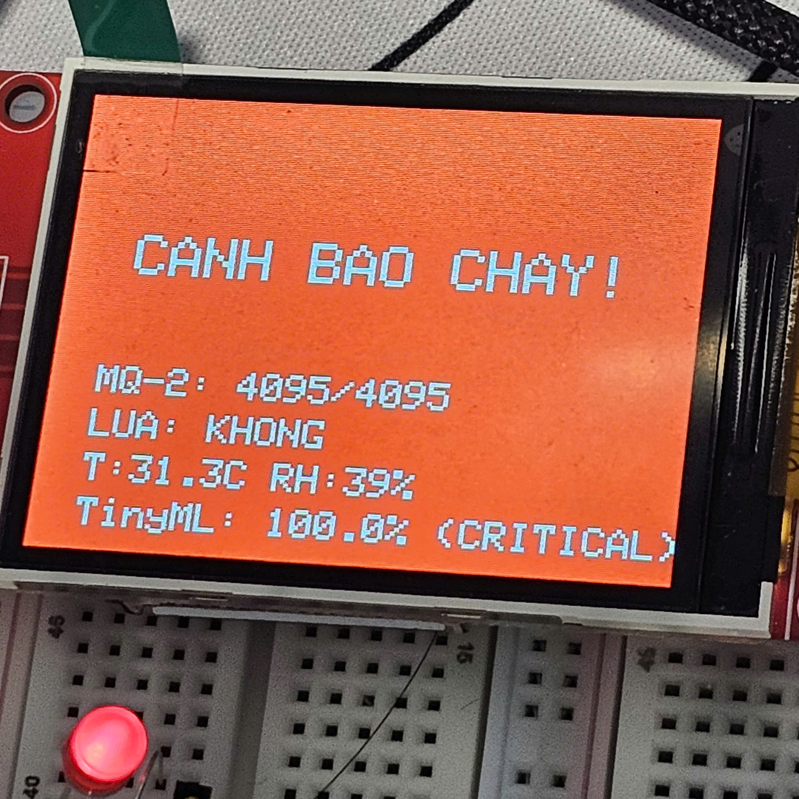
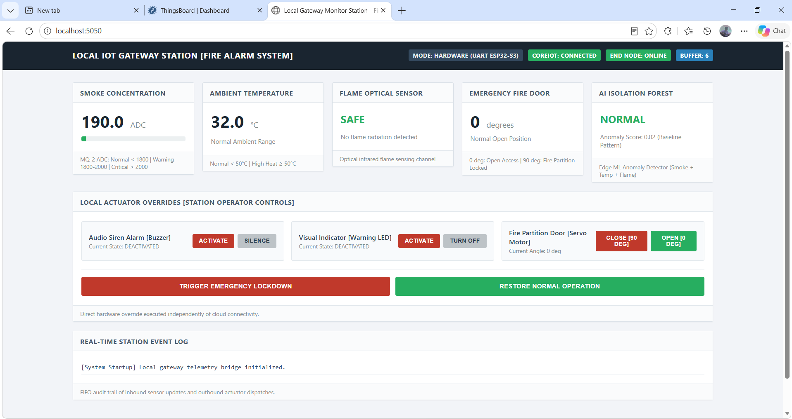
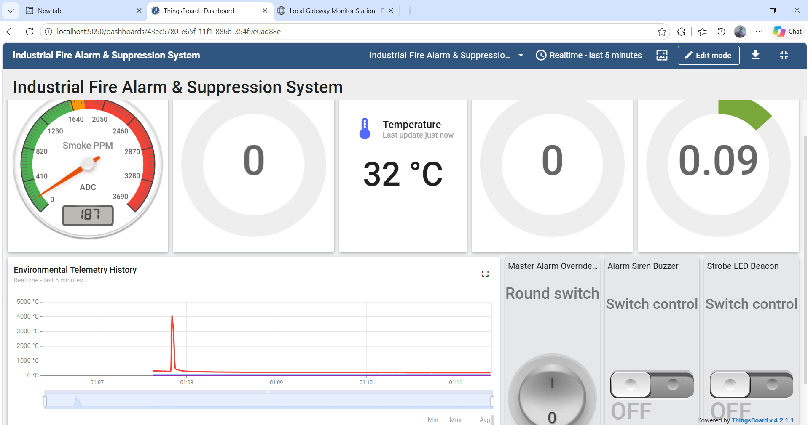

# Hệ Thống Báo Cháy & Điều Khiển Thoát Hiểm Thông Minh (CO3054)


Hệ thống phát hiện cháy sớm và điều khiển cơ cấu ngăn cháy theo kiến trúc IoT 3 tầng (**End-Node ESP32-S3** — **Local IoT Gateway** — **ThingsBoard/CoreIOT**). Dự án kết hợp **Dual-AI** (TinyML nội suy trực tiếp trên vi điều khiển mỗi `100 ms` song song với Isolation Forest phát hiện bất thường đa biến trên Gateway), cơ chế đệm ngoại tuyến **SQLite WAL** chống mất gói khi đứt mạng, cùng giám sát — điều khiển 2 chiều trên **Local SCADA (`:5050`)** và **ThingsBoard Industrial Dashboard (`:9090`)**.

---

## 1. Kiến trúc hệ thống



---

## 2. Cấu trúc thư mục

```text
CO3054-IoT-BTL-FireAlarm/
├── 01_Firmware_EndNode/       # Firmware ESP32-S3 (PlatformIO) & pipeline TinyML
│   ├── include/               # tinyml_fire_model.h (C header model), lv_conf.h
│   ├── src/main.cpp           # Đọc cảm biến, suy luận TinyML, TFT, Servo/Buzzer/LED, UART
│   └── tinyml/train_tinyml.py # Tổng hợp 2.500 mẫu, huấn luyện & export model TinyML
├── 02_Local_Gateway/          # Local IoT Gateway (PC) & triển khai ThingsBoard
│   ├── hardware_gateway/      # LocalGateway.py (UART <-> MQTT QoS 1, Device & Gateway API)
│   ├── ui/                    # SCADA Web :5050 + SQLite WAL, Isolation Forest (T09)
│   └── dashboard/             # docker-compose.yml, deploy & auto-provision Dashboard
├── 03_CoreIOT_Config/         # Rule Chain JSON & script nạp/kiểm thử/đo độ trễ E2E
├── 04_Docs_Media/             # Báo cáo LaTeX (6 chương), slide & latency_results.csv
├── captured_picture/          # 12 ảnh chụp minh chứng phần cứng & giao diện thực tế
├── run_system.py              # Script khởi chạy tổng thể (Gateway + tự mở 2 Dashboard)
├── HUONG_DAN_CHAY.md          # Hướng dẫn cài đặt môi trường & vận hành chi tiết
└── KICH_BAN_QUAY_DEMO.md      # Kịch bản demo & bảng đối chiếu minh chứng chấm điểm
```

---

## 3. Cấu hình phần cứng & Sơ đồ nối chân

Bo mạch: **OhStem YoloUNO (ESP32-S3)** — PlatformIO `[env:yolo_uno]` (`esp32-s3-devkitc-1`, `arduino`, `115200 baud`).

| Linh kiện | Chân YoloUNO | Chân GPIO | Giao tiếp / Chức năng |
| :--- | :---: | :---: | :--- |
| **Cảm biến khói/gas MQ-2** | `A0` | `GPIO 1` | ADC 12-bit (`0–4095`), ngưỡng trễ báo/xóa `1800 / 1650`, chu kỳ `100 ms` |
| **Cảm biến lửa (Flame)** | `D6` | `GPIO 9` | Digital `INPUT_PULLUP` (`ACTIVE LOW`), chu kỳ `100 ms` |
| **Cảm biến DHT11** | `D7` | `GPIO 10` | Digital 1-Wire, ngưỡng trễ nhiệt `35.0°C / 34.0°C`, chu kỳ `2000 ms` |
| **Màn hình TFT ILI9341** | `D10/D4/D5/D11/D9` | `GPIO 21/7/8/38/18` | SPI (`CS/DC/RST/MOSI/SCK`), `320×240` hiển thị thông số & `% TinyML` |
| **Động cơ Servo (Cửa)** | `D2` | `GPIO 5` | PWM (`1000–2000 µs`), `0°` mở / `180°` đóng (`SERVO_COMMAND_SCALE = 2`) |
| **Còi báo động (Buzzer)** | `D3` | `GPIO 6` | Digital / Tone PWM `500 Hz` cảnh báo âm thanh tại chỗ |
| **Đèn LED cảnh báo** | `D8` | `GPIO 17` | Digital Output (`HIGH` khi có cháy hoặc bật cưỡng bức) |

---

## 4. Hướng dẫn khởi chạy nhanh (Quick Start)

> Xem hướng dẫn đầy đủ (cài thư viện, nạp firmware, xử lý sự cố) tại [`HUONG_DAN_CHAY.md`](./HUONG_DAN_CHAY.md) và kịch bản demo tại [`KICH_BAN_QUAY_DEMO.md`](./KICH_BAN_QUAY_DEMO.md).

```powershell
# 1. Cài đặt thư viện Python phụ thuộc
pip install pyserial paho-mqtt requests scikit-learn numpy

# 2. Khởi chạy ThingsBoard Local trên Docker (:9090 HTTP, :1883 MQTT) & tự động cấp phát
python 02_Local_Gateway/dashboard/deploy_thingsboard.py
python 02_Local_Gateway/dashboard/setup_thingsboard_dashboard.py
python 03_CoreIOT_Config/scripts/setup_rule_chain.py --host localhost --port 9090

# 3. (Tùy chọn) Huấn luyện lại & xuất model TinyML ra include/tinyml_fire_model.h
python 01_Firmware_EndNode/tinyml/train_tinyml.py

# 4. Khởi chạy toàn bộ hệ thống (tự dò cổng COM & mở SCADA :5050 + ThingsBoard :9090)
python run_system.py

# Hoặc chạy chế độ ThingsBoard Gateway API cho thiết bị con YOLOUNO_FIRE_NODE_01 (T15)
python 02_Local_Gateway/hardware_gateway/LocalGateway.py --broker localhost --gateway-api
```

---

## 5. Tiêu chí đạt được (CO3054) & Hình ảnh thực tế

| Nhóm | Mã | Nội dung hiện thực đã kiểm chứng trong mã nguồn | Điểm |
| :--- | :---: | :--- | :---: |
| **Công nghệ** | **T04** | Nội suy TinyML trực tiếp trên ESP32-S3 (`tinyml_fire_model.h`, ~128 B RAM) | `1.0` |
| **Công nghệ** | **T05** | Pipeline tổng hợp dữ liệu, huấn luyện & export C header (`train_tinyml.py`, 100% test acc) | `1.0` |
| **Công nghệ** | **T08** | Local IoT Gateway trên PC: cầu nối UART 115200 ↔ MQTT QoS 1 & RPC 2 chiều | `1.0` |
| **Công nghệ** | **T09** | AI Isolation Forest chạy trên Gateway phát hiện bất thường đa biến (`isolation_detector.py`) | `1.0` |
| **Công nghệ** | **T10** | Giao diện SCADA cục bộ (`http://localhost:5050`) giám sát & điều khiển cưỡng bức | `1.0` |
| **Công nghệ** | **T11** | Industrial Dashboard 10 widget trên lưới 24 cột dựng tự động từ template ThingsBoard 3.x | `1.0` |
| **Công nghệ** | **T12** | Rule Chain tự động phân loại nguy cơ cháy, tạo/xóa Alarm & phát lệnh RPC | `1.0` |
| **Công nghệ** | **T13** | Cảnh báo Notification vượt ngưỡng thời gian thực trên Widget 10 (`alarm_notification`) | `0.5` |
| **Công nghệ** | **T15** | Đồng bộ Gateway (`Is gateway: TRUE`, `--gateway-api`) + đệm ngoại tuyến SQLite WAL | `2.0` |
| **Nâng cao** | **N06** | Dashboard tự thiết kế tích hợp phát hiện cháy & lưu vết sự kiện FIFO (`Event Log`) | `+1.0` |
| **Nâng cao** | **N07** | Tự triển khai ThingsBoard CE + PostgreSQL cục bộ bằng Docker (`docker-compose.yml`) | `+1.0` |

> **Tổng điểm tự đánh giá:** Công nghệ `min(8.0, 9.5) = 8.0/8.0` · Nâng cao `min(1.0, 2.0) = 1.0/1.0` · Báo cáo `2.0/2.0` → **Tối đa `10.0 / 10.0`** (theo công thức quy chế môn học).

| Phần cứng báo cháy + TinyML (`T04`) | Local SCADA Monitor (`T10`, `N06`) | ThingsBoard Dashboard (`T11`, `T13`) |
| :---: | :---: | :---: |
|  |  |  |

---

## 6. Nhóm thực hiện & Thông tin học phần

- **Trường:** Đại học Bách Khoa — ĐHQG TP.HCM (HCMUT) — Khoa Khoa học và Kỹ thuật Máy tính
- **Môn học:** Phát triển Ứng dụng IoT (`CO3054`) — **Giảng viên hướng dẫn:** TS. Lê Trọng Nhân

| STT | Họ và tên | MSSV | Email |
| :---: | :--- | :---: | :--- |
| 1 | Nguyễn Tiến Minh Trí | `2413648` | `tri.nguyen2606bku@hcmut.edu.vn` |
| 2 | Phạm Nghĩa Trung | `2413713` | `trung.phamnghia@hcmut.edu.vn` |
| 3 | Đào Nhật Toàn | `2413523` | `toan.daonhat@hcmut.edu.vn` |
