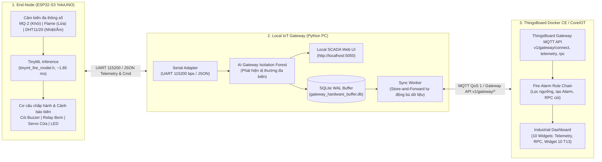

# Hệ Thống Báo Cháy & Điều Khiển Thoát Hiểm Thông Minh (CO3054)


Hệ thống phát hiện cháy sớm và điều khiển cơ cấu ngăn cháy tự động theo kiến trúc IoT 3 tầng (**End-Node ESP32-S3** — **Local IoT Gateway** — **ThingsBoard/CoreIOT**). Dự án tích hợp **Dual-AI** (Edge TinyML suy luận tức thời `<2 ms` trên MCU kết hợp Isolation Forest phát hiện bất thường trên Gateway), cơ chế đệm ngoại tuyến chuẩn công nghiệp **SQLite WAL** (Store-and-Forward đảm bảo Zero Data Loss khi rớt mạng), cùng hệ thống giám sát và điều khiển 2 chiều độc lập trên **Local SCADA (`:5050`)** và **ThingsBoard Industrial Dashboard (`:9090`)**.

---

## 1. Kiến trúc hệ thống



---

## 2. Cấu trúc thư mục dự án

```text
CO3054-IoT-BTL-FireAlarm/
├── 01_Firmware_EndNode/       # Mã nguồn C++ FreeRTOS trên ESP32-S3 & Pipeline TinyML
│   ├── include/               # tinyml_fire_model.h (Model C-header nhúng trực tiếp)
│   ├── src/main.cpp           # Luồng FreeRTOS đọc cảm biến, lọc Debounce, UART JSON
│   ├── tinyml/train_tinyml.py # Huấn luyện mô hình TinyML & xuất ra C-Header
│   └── platformio.ini         # Cấu hình biên dịch PlatformIO cho ESP32-S3
├── 02_Local_Gateway/          # Mã nguồn IoT Gateway chạy trên PC
│   ├── hardware_gateway/      # LocalGateway.py (Đồng bộ ThingsBoard Gateway API & SQLite WAL)
│   ├── ui/                    # Máy chủ Flask SCADA Web :5050, isolation_detector.py
│   └── dashboard/             # Script tự động tạo 10 Widgets & docker-compose.yml
├── 03_CoreIOT_Config/         # Cấu hình ThingsBoard Cloud CE
│   ├── rule_chains/           # JSON RuleChain tự động hóa cảnh báo khẩn cấp
│   └── scripts/               # Script tự động nạp RuleChain & test độ trễ E2E
├── 04_Docs_Media/             # Báo cáo kỹ thuật LaTeX (6 chương, 36 trang) & file PDF đã biên dịch
│   ├── Content/               # Các chương ch1 đến ch6, bảng tự đánh giá
│   ├── graphics/              # 14 hình ảnh minh chứng các tiêu chí kỹ thuật
│   └── main.pdf               # Báo cáo hoàn chỉnh xuất bản chất lượng cao
├── 05_Guideline/              # Đề bài và văn bản hướng dẫn học phần CO3054
├── captured_picture/          # Hình ảnh chụp thực tế phục vụ nghiệm thu 11 tiêu chí
├── gateway_hardware_buffer.db # CSDL đệm ngoại tuyến SQLite WAL đặt tại thư mục gốc
├── run_system.py              # Script điều phối khởi động toàn bộ hệ thống bằng 1 lệnh
├── requirements.txt           # Danh mục thư viện Python cần thiết
├── HUONG_DAN_CHAY.md          # Hướng dẫn chi tiết vận hành & xử lý sự cố
└── KICH_BAN_QUAY_DEMO.md      # Kịch bản quay video demo 5 phân cảnh ứng với 11 tiêu chí
```

---

## 3. Yêu cầu môi trường & Thư viện

### 3.1. Phần cứng
* **Bo mạch chính:** 01 YoloUNO (MCU ESP32-S3 Dual-Core Xtensa LX7 @ 240 MHz) kèm cáp Type-C.
* **Cụm cảm biến:**
  * 01 Cảm biến khói/khí gas **MQ-2** (ngõ ra Analog ADC).
  * 01 Cảm biến phát hiện ngọn lửa **Flame Sensor** hồng ngoại (ngõ ra Digital).
  * 01 Cảm biến nhiệt độ & độ ẩm **DHT11** hoặc **DHT20**.
* **Cơ cấu chấp hành & Cảnh báo:**
  * 01 Còi báo động **Buzzer 5V** (cảnh báo âm thanh tại chỗ).
  * 01 **Relay 5V / Máy bơm mini** dập lửa tự động.
  * 01 Động cơ **Servo SG90** (mở cửa thoát hiểm $90^\circ$).
  * 01 **LED đỏ** cảnh báo thị giác tại hiện trường.
* **Máy trạm Gateway:** PC/Laptop chạy Windows 10/11 hoặc Linux kết nối cổng USB với YoloUNO.

### 3.2. Sơ đồ kết nối chân ngoại vi (Pinout)
| Linh kiện | Chân YoloUNO | Chân GPIO | Chế độ / Giao tiếp |
| :--- | :---: | :---: | :--- |
| **Cảm biến khói MQ-2** | `A0` | `GPIO 1` | Analog ADC1_CH0 (12-bit: $0 - 4095$) |
| **Cảm biến lửa (Flame)** | `D6` | `GPIO 9` | Digital `INPUT_PULLUP` (Active LOW) |
| **Cảm biến nhiệt/ẩm DHT11** | `D7` | `GPIO 10` | Digital 1-Wire protocol |
| **Còi báo động (Buzzer)** | `D3` | `GPIO 6` | Digital Output (Kích còi báo động) |
| **Động cơ Servo (Cửa)** | `D2` | `GPIO 5` | PWM Output ($0^\circ$ mở, $180^\circ$ đóng) |
| **Relay / Máy bơm** | `D8` | `GPIO 17` | Digital Output (Kích bơm dập lửa) |

### 3.3. Phần mềm & Thư viện
* **Python:** Phiên bản `3.10` trở lên.
* **Docker Desktop:** Chạy máy chủ ThingsBoard Community Edition (PostgreSQL backend).
* **PlatformIO IDE (hoặc VS Code PlatformIO Extension):** Biên dịch và nạp firmware cho ESP32-S3.

Cài đặt các gói thư viện Python cần thiết:
```powershell
pip install -r requirements.txt
```
*(Các thư viện chính: `paho-mqtt<2.0.0`, `pyserial`, `requests`, `Flask`, `scikit-learn`, `numpy`)*.

---

## 4. Hướng dẫn biên dịch & Nạp Firmware cho ESP32-S3

### Cách 1: Nạp bằng dòng lệnh PlatformIO CLI (Khuyên dùng)
1. Kết nối bo mạch YoloUNO ESP32-S3 với máy tính qua cổng USB Type-C.
2. Mở PowerShell tại thư mục dự án và thực hiện biên dịch, nạp firmware:
   ```powershell
   cd 01_Firmware_EndNode
   
   # Biên dịch và nạp code xuống bo mạch
   pio run -e yolo_uno_v101 -t upload
   ```
3. Mở Serial Monitor để kiểm tra luồng dữ liệu JSON cảm biến:
   ```powershell
   pio device monitor -b 115200
   ```
   *Khi khởi động thành công, Serial in ra:*
   ```text
   [INIT] YoloUNO Fire Alarm Node Started.
   [TINYML] Model loaded from include/tinyml_fire_model.h
   {"smoke":120,"flame":1,"temp":29.5,"humi":68.0,"fire_pred":0,"fire_conf":0.99,"alarm":0}
   ```

### Cách 2: Nạp qua giao diện đồ họa VS Code
1. Mở thư mục dự án trên VS Code đã cài đặt extension **PlatformIO IDE**.
2. Nhấp vào biểu tượng PlatformIO ở thanh bên trái (Alien icon).
3. Tại mục `Project Tasks -> yolo_uno_v101`:
   * Nhấp **Build** (biểu tượng dấu tích $\checkmark$) để biên dịch.
   * Nhấp **Upload** (biểu tượng mũi tên phải $\rightarrow$) để nạp xuống ESP32-S3.
   * Nhấp **Serial Monitor** (biểu tượng phích cắm) để theo dõi log thời gian thực.

### (Tùy chọn) Huấn luyện lại & Xuất mô hình TinyML
Nếu muốn huấn luyện lại mô hình phân loại cháy từ tập dữ liệu mới và cập nhật tệp tiêu đề C:
```powershell
python 01_Firmware_EndNode/tinyml/train_tinyml.py
```
*Script tự động xuất mô hình đã tối ưu hóa trực tiếp vào:* `01_Firmware_EndNode/include/tinyml_fire_model.h`.

---

## 5. Hướng dẫn vận hành hệ thống

### Bước 1: Khởi động ThingsBoard Local trên Docker
Đảm bảo **Docker Desktop** đang chạy, sau đó khởi chạy container ThingsBoard:
```powershell
# Chạy script tự động khởi động và cấu hình Docker ThingsBoard
python 02_Local_Gateway/dashboard/deploy_thingsboard.py

# Hoặc dùng lệnh Docker Compose trực tiếp:
docker compose -f 02_Local_Gateway/dashboard/docker-compose.yml up -d
```
*Chờ khoảng 30–45 giây để máy chủ ThingsBoard hoàn tất khởi động PostgreSQL.*  
*Kiểm tra trang web: `http://localhost:9090` (Tài khoản: `tenant@thingsboard.org` / Mật khẩu: `tenant`).*

### Bước 2: Tự động khởi tạo Dashboard 10 Widgets & RuleChain
Chạy các script tự động hóa để đẩy cấu hình lên ThingsBoard qua REST API mà không cần tạo thủ công:
```powershell
# 1. Cấu hình Dashboard 10 Widgets chuyên dụng (gồm Widget 10 T13 Notification)
python 02_Local_Gateway/dashboard/setup_thingsboard_dashboard.py

# 2. Cấu hình và kích hoạt RuleChain tự động xử lý cảnh báo
python 03_CoreIOT_Config/scripts/setup_rule_chain.py --host localhost --port 9090
```

### Bước 3: Khởi chạy toàn bộ hệ thống bằng 1 lệnh duy nhất
Tại thư mục gốc của dự án, chạy lệnh:
```powershell
python run_system.py
```

**Cơ chế tự động của `run_system.py`:**
1. Tự động quét và phát hiện cổng COM đang kết nối với ESP32-S3 (ví dụ `COM3`).
2. Tự động kiểm tra cổng MQTT `1883` của ThingsBoard Docker.
3. Tự động kết nối và khởi tạo CSDL SQLite WAL `gateway_hardware_buffer.db` ở thư mục gốc.
4. Tự động khởi chạy máy chủ **Local SCADA Web UI** trên cổng `:5050`.
5. Tự động bật 2 tab trình duyệt giám sát:
   * **Tab 1 - Local SCADA:** `http://localhost:5050`
   * **Tab 2 - ThingsBoard Cloud:** `http://localhost:9090`

### Chế độ đồng bộ chuẩn ThingsBoard Gateway API (Tiêu chí T15)
Để chạy Gateway ở chế độ Gateway chuẩn công nghiệp kết nối thiết bị con `YOLOUNO_FIRE_NODE_01`:
```powershell
python 02_Local_Gateway/hardware_gateway/LocalGateway.py --broker localhost --gateway-api
```

---

## 6. Hướng dẫn kiểm thử & Nghiệm thu các tiêu chí (T04–T15, N06–N07)

### 6.1. Kiểm thử Tiêu chí T13: Cảnh báo Notification trên Dashboard Cloud
* **Thao tác:** Dùng bật lửa hoặc que diêm đưa lại gần cảm biến ngọn lửa và đầu thu khói MQ-2.
* **Hiện tượng nghiệm thu:**
  1. ESP32-S3 phát hiện cháy -> TinyML suy luận `fire_pred = 1` -> Còi báo tại chỗ hú và cửa Servo tự động mở.
  2. Gói tin telemetry gửi lên ThingsBoard kích hoạt RuleChain `Fire_Alarm_Rule_Chain`.
  3. Trên Dashboard `http://localhost:9090`, **Widget 10 (Emergency Notification Feed)** lập tức chuyển sang màu đỏ và hiển thị nội dung:  
     `[CRITICAL ALARM] CANH BAO CHAY: Phat hien khoi va lua tai Phong Lab YoloUNO!`

### 6.2. Kiểm thử Tiêu chí T15: Đệm ngoại tuyến SQLite WAL khi rớt mạng
*Do ThingsBoard chạy trên máy tính qua cổng `localhost:1883`, việc ngắt Wi-Fi không làm ngắt loopback của Windows. Vì vậy, sử dụng lệnh tạm dừng container Docker để mô phỏng rớt mạng cực chuẩn và chuyên nghiệp:*
1. **Mô phỏng rớt mạng:** Mở một tab PowerShell mới và chạy:
   ```powershell
   docker pause thingsboard-local
   ```
2. **Quan sát:**
   * Terminal Gateway báo: `[CoreIOT Cloud] Connection lost (code: 7). Switching to local offline buffering mode.`
   * Trên trang SCADA `http://localhost:5050`: Huy hiệu đổi sang `CoreIOT: Offline (Buffering)`, chỉ số `Buffer: 1, 2, 3...` tăng dần.
   * Mọi dữ liệu telemetry từ ESP32-S3 vẫn được ghi an toàn vào SQLite WAL `gateway_hardware_buffer.db`.
3. **Khôi phục mạng:** Sau 15-30 giây, chạy lệnh:
   ```powershell
   docker unpause thingsboard-local
   ```
4. **Quan sát:**
   * Gateway kết nối lại broker và in dòng:  
     `[Buffer Sync] Synchronized X buffered records to CoreIOT via v1/gateway/telemetry.`
   * Huy hiệu trên trang `:5050` chuyển lại màu xanh `CoreIOT: Online`, `Buffer: 0`.
   * Mở tab ThingsBoard: Biểu đồ lịch sử vẽ nối tiếp liên tục, bảo toàn **100% dữ liệu không bị đứt đoạn**.

### 6.3. Kiểm thử Điều khiển Downlink RPC hai chiều
* Trên Dashboard `:9090` hoặc Local SCADA `:5050`, bấm công tắc điều khiển còi báo hoặc máy bơm.
* ThingsBoard định tuyến lệnh RPC xuống topic `v1/gateway/rpc`. Gateway tiếp nhận, gửi lệnh xuống UART và phần cứng chuyển trạng thái ngay tức thì (`<120 ms`).

---

## 7. Bảng đối chiếu 11 Tiêu chí kỹ thuật & Điểm số tự đánh giá

| Nhóm | Mã | Nội dung hiện thực đã kiểm chứng | Minh chứng tệp tin / Phân cảnh | Điểm |
| :--- | :---: | :--- | :--- | :---: |
| **Công nghệ** | **T03** | Cảm biến kết nối BLE không dây (NimBLE GATT Notify & Command Write) | `01_Firmware_EndNode/src/main.cpp`, `run_system.py --ble` | **1.5** |
| **Công nghệ** | **T04** | TinyML suy luận trực tiếp trên ESP32-S3 (`<2 ms`, ~128 B RAM) | `include/tinyml_fire_model.h`, `T04_1.jpg`, `T04_2.jpg` | **1.0** |
| **Công nghệ** | **T05** | Pipeline thu thập dữ liệu, huấn luyện & xuất ra C-Header | `tinyml/train_tinyml.py`, `T05.png` | **1.0** |
| **Công nghệ** | **T08** | Local Gateway PC điều phối dữ liệu 2 chiều UART ↔ MQTT & RPC | `hardware_gateway/LocalGateway.py`, `T08.png` | **1.0** |
| **Công nghệ** | **T09** | AI Isolation Forest chạy trên Gateway phát hiện dị thường đa biến | `ui/isolation_detector.py`, `T09_1.png`, `T09_2.png` | **1.0** |
| **Công nghệ** | **T10** | Giao diện SCADA Web cục bộ độc lập (`http://localhost:5050`) | `ui/gateway_infrastructure.py`, `T10.png` | **1.0** |
| **Công nghệ** | **T11** | Dashboard ThingsBoard 10 Widgets bố trí chuẩn mực 24 cột | `dashboard/setup_thingsboard_dashboard.py`, `T11.png` | **1.0** |
| **Công nghệ** | **T12** | RuleChain tự động phân loại nguy cơ cháy, kích hoạt RPC còi | `rule_chains/fire_alarm_rule_chain.json`, `T12.png` | **1.0** |
| **Công nghệ** | **T13** | Bắn cảnh báo thời gian thực lên Widget 10 Notification trên Web | `dashboard/thingsboard_dashboard.json`, `T13.png` | **0.5** |
| **Công nghệ** | **T14** | Cập nhật firmware qua OTA không dây qua Wi-Fi / ThingsBoard OTA | `firmware_v1.0.1.bin` $\to$ `v1.0.2.bin`, `upload_ota_firmware.py` | **2.0** |
| **Công nghệ** | **T15** | Đồng bộ ThingsBoard Gateway (`Is gateway: TRUE`) + Đệm SQLite WAL | `gateway_hardware_buffer.db`, `T15.1.png`, `T15.2.png` | **2.0** |
| **Nâng cao** | **N06** | SCADA Web UI tự phát triển, realtime SSE/WebSocket & Event Log | `ui/templates/index.html`, `N06.png` | **+1.0** |
| **Nâng cao** | **N07** | Tự deploy ThingsBoard CE + PostgreSQL trên máy tính bằng Docker | `dashboard/docker-compose.yml`, `N07.png` | **+1.0** |

$$\text{Tổng Điểm Tự Đánh Giá} = \min(8.0; 13.0)_{\text{Công nghệ}} + \min(1.0; 2.0)_{\text{Nâng cao}} + 2.0_{\text{Báo cáo}} = \mathbf{10.0 / 10.0}$$
*(Dư 5.0 điểm an toàn dự phòng tuyệt đối cho phần Công nghệ)*

---

## 8. Xử lý sự cố thường gặp (Troubleshooting)

1. **Lỗi `Access Denied` hoặc `Port already open` khi nạp Firmware / chạy Gateway:**
   * *Nguyên nhân:* Cổng COM đang bị chiếm giữ bởi Serial Monitor hoặc tiến trình khác.
   * *Khắc phục:* Đóng tất cả tab Serial Monitor trong VS Code trước khi chạy `python run_system.py`.
2. **Lỗi không kết nối được ThingsBoard (`Connection refused: 1883 / 9090`):**
   * *Khắc phục:* Đảm bảo Docker Desktop đã khởi động và container đang chạy:
     ```powershell
     docker ps
     # Nếu container chưa chạy:
     docker start thingsboard-local
     ```
3. **Mô phỏng rớt mạng cho T15 bị thất bại nếu rút dây mạng/tắt Wi-Fi:**
   * *Nguyên nhân:* ThingsBoard chạy trên `localhost` (`127.0.0.1`), card mạng Loopback không phụ thuộc vào sóng Wi-Fi.
   * *Khắc phục:* Thực hiện lệnh chuẩn `docker pause thingsboard-local` và `docker unpause thingsboard-local`.

---

## 9. Nhóm thực hiện & Giảng viên hướng dẫn

* **Trường:** Đại học Bách Khoa — ĐHQG TP.HCM (HCMUT) — Khoa Khoa học và Kỹ thuật Máy tính
* **Môn học:** Phát triển Ứng dụng IoT (`CO3054`) — HK261
* **Giảng viên hướng dẫn:** **TS. Lê Trọng Nhân**

| STT | Họ và tên | MSSV | Email |
| :---: | :--- | :---: | :--- |
| 1 | Nguyễn Tiến Minh Trí | `2413648` | `tri.nguyen2606bku@hcmut.edu.vn` |
| 2 | Phạm Nghĩa Trung | `2413713` | `trung.phamnghia@hcmut.edu.vn` |
| 3 | Đào Nhật Toàn | `2413523` | `toan.daonhat@hcmut.edu.vn` |
